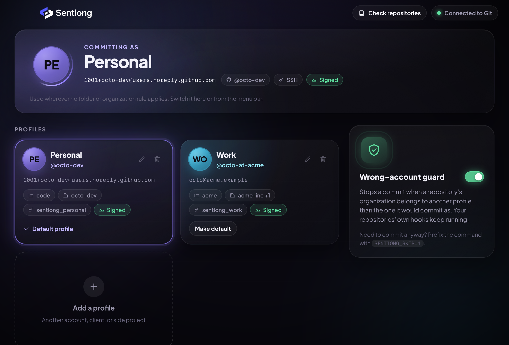
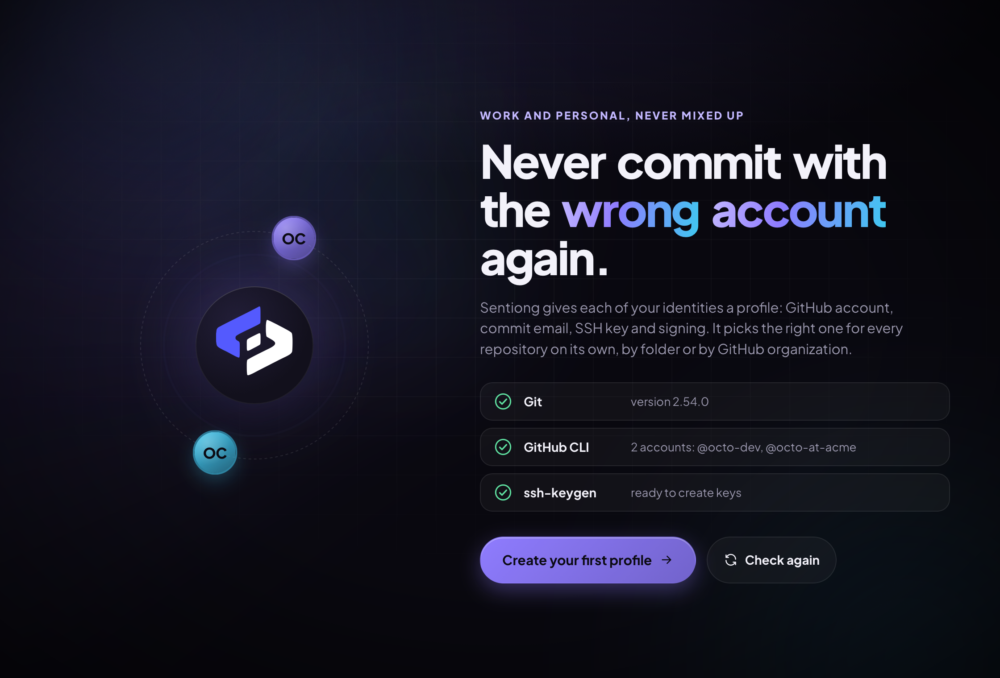
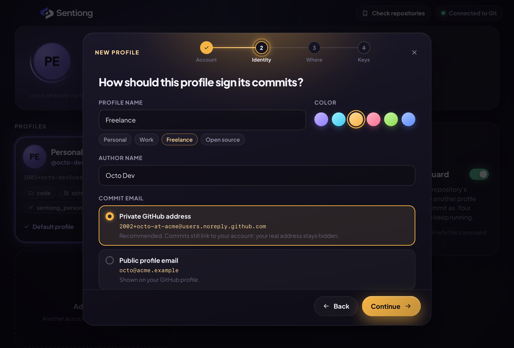
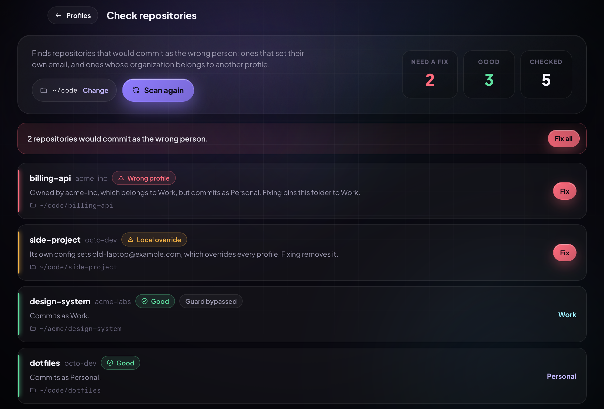

<div align="center">

<h1>
  <picture>
    <source media="(prefers-color-scheme: dark)" srcset="docs/assets/brand/sentiong-logo-dark.svg">
    
  </picture>
</h1>

<p><strong>Never commit with the wrong GitHub account again.</strong></p>

<p>
  <a href="https://github.com/ramizbrain/sentiong/releases/latest"></a>
  <a href="LICENSE"></a>
  
  
  
</p>



<table>
  <tr>
    <td></td>
    <td></td>
  </tr>
  <tr>
    <td colspan="2"></td>
  </tr>
</table>

</div>

---

## Why Sentiong?

If you have a work and a personal GitHub account on one machine, you know the routine:
`gh auth switch`, `git config user.email`, the SSH key that only belongs to one of them, and
the commit that went out with the wrong email anyway.

Sentiong turns each identity into a **profile** (GitHub account, commit author, SSH key and
signing) and picks the right one for every repository on its own. You set it up once in a
friendly wizard. After that there is nothing to switch.

## Features

- **Profiles that apply themselves.**
  - **Folder rules:** everything in `~/work/` commits as Work.
  - **Owner rules:** every repository from the `acme-inc` organization commits as Work,
    wherever you cloned it.
  - **Default profile:** used everywhere else.
- **The right account for pushes too.**
  - **SSH:** each profile has its own key, chosen through `core.sshCommand`, so remote URLs
    never need editing.
  - **HTTPS:** a per-profile credential helper asks `gh` for that profile's token, even when
    another account is active in `gh`.
- **Wrong-account guard.** An optional global `pre-commit` hook stops a commit when the
  repository's owner belongs to a different profile. Your repositories' own hooks
  (Husky, Git LFS, …) keep running, and `SENTIONG_SKIP=1 git commit …` lets one through.
- **Setup without the terminal.**
  - **Sign in:** connect another GitHub account in the browser.
  - **Keys:** create an SSH key, upload it to GitHub, and register it for signed commits
    (the *Verified* badge).
  - **Email:** use GitHub's private `noreply` address in one click.
- **Repository check.** Scan a folder and find repositories that would commit as the wrong
  person, such as a stray local `user.email` or a work repository under a personal folder,
  then fix them one by one or all at once.
- **Menu bar / tray switcher.** Change the default profile without opening the window. It
  also switches the active `gh` account.
- **Fully animated, dark UI.** The whole app takes on the default profile's color. Cards tilt,
  device codes flip in, and setup steps check themselves off. All motion respects your OS's
  *Reduce motion* setting.

## How it works (and how to undo it)

Sentiong only writes files it owns, under `~/.config/sentiong/`, plus **one marked block** at
the end of `~/.gitconfig`:

```ini
# >>> sentiong >>>
# Added by Sentiong. Remove it from the app (Connected to Git > Disconnect) or delete these lines.
[include]
	path = "/Users/you/.config/sentiong/git/sentiong.gitconfig"
# <<< sentiong <<<
```

That file includes your default profile, then the folder rules (`includeIf "gitdir:…"`),
then the owner rules (`includeIf "hasconfig:remote.*.url:…"`). Git applies later settings over
earlier ones, so owner rules win over folder rules, and folder rules win over the default.
Each profile lives in `~/.config/sentiong/git/profiles/<id>.gitconfig`.

- `~/.gitconfig` is **backed up** to `~/.config/sentiong/backups/` before every change.
  The last 10 backups are kept.
- **Disconnect** in the app removes the block and the guard. Your profiles stay saved, so
  reconnecting restores everything.
- Tokens are **never stored by Sentiong**. `gh` keeps them in your system keychain, and
  Sentiong hands them to `gh` in memory only when it needs one.
- New SSH keys are ed25519 keys named `~/.ssh/sentiong_<profile>`, without a passphrase, so
  Git can use them without prompting. Existing files are never overwritten.

### Requirements

| Tool | Needed for |
| --- | --- |
| Git (2.36+ for owner rules) | everything |
| [GitHub CLI](https://cli.github.com) (`gh`) | GitHub accounts, key upload, HTTPS credentials, switching `gh` |
| `ssh-keygen` (OpenSSH) | creating SSH keys |

Without `gh`, a profile can still set a commit name, email, SSH key and signing.

## Installation

### Download

Grab the latest version from the **[Releases page](https://github.com/ramizbrain/sentiong/releases/latest)**:

| OS | File |
| --- | --- |
| macOS (Apple Silicon and Intel) | `Sentiong_x.y.z_universal.dmg` |
| Windows 10/11 | `Sentiong_x.y.z_x64-setup.exe` (or the `.msi`) |
| Linux | `Sentiong_x.y.z_amd64.AppImage`, `.deb`, or `.rpm` |

#### Opening Sentiong for the first time

The builds are not signed with a paid Apple or Microsoft certificate yet:

- **macOS:** drag Sentiong to Applications and open it. When macOS says it can't verify the
  app, open **System Settings → Privacy & Security**, scroll down, and click **Open Anyway**.
  If macOS says the app "is damaged", run `xattr -cr /Applications/Sentiong.app`.
- **Windows:** if SmartScreen shows "Windows protected your PC", click **More info → Run anyway**.

### Build from source

Prerequisites: [Node.js](https://nodejs.org) 20+, [pnpm](https://pnpm.io),
[Rust](https://www.rust-lang.org/tools/install) 1.85+, and the
[Tauri prerequisites](https://tauri.app/start/prerequisites/) for your OS.

```bash
git clone https://github.com/ramizbrain/sentiong.git
cd sentiong
pnpm install
pnpm tauri build
```

The installer or app bundle is written to `src-tauri/target/release/bundle/`.

## Development

```bash
pnpm install
pnpm tauri dev      # the real app, with hot reload
pnpm dev            # the UI alone in a browser, backed by an in-memory demo
```

The browser demo never touches your Git config. Open `http://localhost:1420/?demo=full` to
start with sample profiles instead of the first-run screen.

| Command | What it does |
| --- | --- |
| `pnpm test` | Frontend unit and component tests (Vitest + Testing Library) |
| `pnpm lint` | ESLint, including the React Hooks rules |
| `pnpm typecheck` | TypeScript in strict mode |
| `pnpm test:rust` | Backend tests, including real `git` runs in throwaway home folders |
| `cargo clippy --manifest-path src-tauri/Cargo.toml --all-targets -- -D warnings` | Rust lints |

A read-only smoke test checks the backend against your real `gh` login:

```bash
cargo test --manifest-path src-tauri/Cargo.toml real_gh -- --ignored --nocapture
```

## Architecture

```
src-tauri/src/            Rust backend
  lib.rs                  wires the app: plugins, state, tray, commands
  commands.rs             thin IPC layer: off the async runtime, into the service
  service.rs              use cases: load state → change → save → apply to Git
  profiles.rs             validation and changes to profiles (pure)
  gitconfig.rs            renders every gitconfig file and the ~/.gitconfig block (pure)
  config_writer.rs        writes those files idempotently, with backups
  guard.rs                the wrong-account pre-commit hook
  gh.rs                   GitHub CLI: accounts, users, key upload
  login.rs                browser device-flow logins through gh
  ssh.rs                  listing and creating SSH keys
  repos.rs                finding repositories and diagnosing their identity
  programs.rs             locating and running git / gh / ssh-keygen
  tray.rs                 the menu bar / tray switcher
  store.rs, paths.rs      state on disk and where everything lives
  models.rs, error.rs     the IPC contract and its error type

src/                      React frontend
  App.tsx                 screens: onboarding → dashboard ⇄ repository check, plus the wizard
  services/               the only door to the backend (Tauri, or the in-browser demo)
  hooks/                  state: snapshot, environment, GitHub login, setup runner, repo scan
  lib/                    pure logic: wizard drafts, setup plan, repo status, colors, formatting
  components/             onboarding, dashboard, wizard, repos, motion, common, brand
  styles/                 design tokens and per-screen styles
  types/                  TypeScript mirrors of the Rust models
```

Principles:

- **Pure core, thin edges.** Rendering Git config, validating profiles, and diagnosing
  repositories are pure functions with unit tests. Only `config_writer`, `programs` and the
  modules that call tools touch the system, and their tests run real `git` and `ssh-keygen`
  in temporary home folders.
- **One way in.** Components never call `invoke`. They use `services/sentiongApi.ts`, which
  is the Rust backend in the app and an in-memory demo in a browser.
- **Explicit contracts.** Every type crossing IPC is mirrored in `types/sentiong.ts`, and
  Rust contract tests pin the JSON. Errors arrive as `{ code, message }`.
- **Motion is presentation.** Animations use [Motion](https://motion.dev). Tests switch them
  off and check behaviour.

## Contributing

Contributions are welcome. Please read [CONTRIBUTING.md](CONTRIBUTING.md) first.

## License

[MIT](LICENSE) © Sentiong contributors
